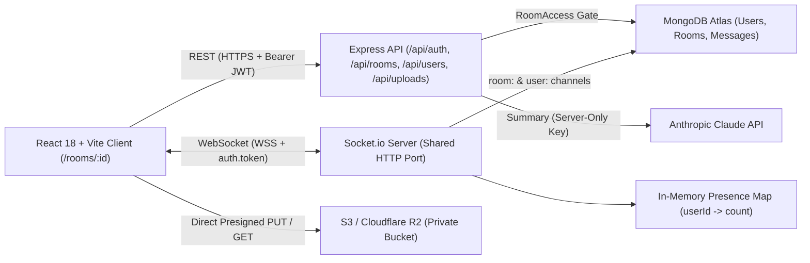
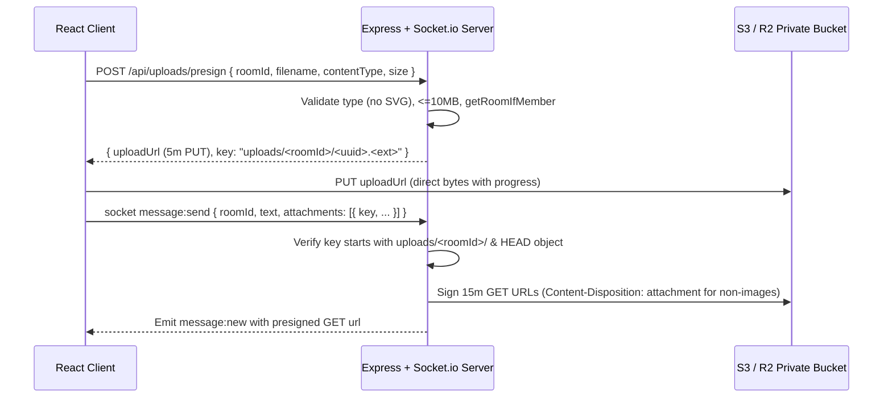

# PulseChat — Real-Time Group Chat, Rooms, Uploads & AI Summaries

A production-style, full-stack real-time chat application built with Node.js, Express, Socket.io, MongoDB/Mongoose, S3/R2 presigned storage, Anthropic Claude AI summaries, and React 18 (Vite).

**Live Demo:** `https://your-deployed-client.vercel.app` *(replace with your deployed URL)*

---

## Features

- **Public Rooms, Private Rooms & 1-to-1 DMs:** Seeded `"General"` public room (auto-joined on registration), discoverable public rooms, owner-managed invite-only private rooms, and race-safe deduplicated DMs.
- **Message Lifecycle:** 15-minute author-only inline editing (`(edited)`), soft-delete by author or room-owner moderation (`"This message was deleted"` tombstone), and `updatedAt`-based `/changes` sync on reconnect.
- **Atomic Emoji Reactions:** 6-emoji allowlist (`👍 ❤️ 😂 🎉 😮 🙏`) updated via atomic MongoDB `$addToSet` / `$pull` operations with hover picker and reactor tooltips.
- **Direct-to-Storage Uploads:** Presigned S3/R2 PUT uploads with progress, cancel/retry, drag-and-drop, clipboard paste, lazy-loaded inline images with lightbox, and private-bucket presigned GET URLs.
- **AI "Catch me up" Summaries:** Server-side Claude API summary of unread (or recent 50) non-deleted messages with prompt-injection delimiters, 5-minute caching, and strict per-user rate limiting.
- **JWT Auth, Presence, Typing & Read Receipts:** Case-insensitive unique usernames, multi-tab presence, room-scoped typing indicators, and `IntersectionObserver` + tab-focus gated read receipts.

---

## Architecture



---

## Authorization Model

All room-scoped REST endpoints and Socket.io handlers pass through [`server/src/services/roomAccess.js`](server/src/services/roomAccess.js) (`getRoomIfMember` / `assertRoomOwner`):
1. Every `roomId` is validated with `mongoose.isValidObjectId` via Zod before any database query (`400` on malformed IDs).
2. Non-members receive `403` for public rooms and `404` for private rooms and DMs so private room existence cannot be enumerated via IDOR.
3. Only members can read history, send/edit/react to messages, presign/attach files, request AI summaries, emit typing, or mark messages read.
4. Only the room `owner` can invite users to a private room, delete a non-General room, or moderate (soft-delete) other users' messages.

---

## REST API Contract

| Method | Endpoint | Auth | Body / Query | Response |
| :--- | :--- | :--- | :--- | :--- |
| `GET` | `/health` | Public | — | `200 { status, uptime, timestamp }` |
| `POST` | `/api/auth/register` | Public (10/15m) | `{ username, password }` | `201 { token, user }` |
| `POST` | `/api/auth/login` | Public (10/15m) | `{ username, password }` | `200 { token, user }` |
| `GET` | `/api/rooms` | Bearer JWT | — | `200 { rooms }` (with `lastMessage`, `unreadCount`, `otherUser`) |
| `GET` | `/api/rooms/public` | Bearer JWT | `?q=&page=1&limit=20` | `200 { rooms, page, limit, total, hasMore }` |
| `POST` | `/api/rooms` | Bearer JWT | `{ name, type, memberIds? }` | `201 { room }` |
| `POST` | `/api/rooms/dm` | Bearer JWT | `{ userId }` | `200/201 { room, created }` |
| `POST` | `/api/rooms/:id/join` | Bearer JWT | — | `200 { room }` |
| `POST` | `/api/rooms/:id/members` | Owner JWT | `{ memberIds }` | `200 { room, addedMemberIds }` |
| `DELETE` | `/api/rooms/:id/members/me` | Bearer JWT | — | `200 { ok, roomId }` |
| `DELETE` | `/api/rooms/:id` | Owner JWT | — | `200 { ok, roomId }` |
| `GET` | `/api/rooms/:id/messages` | Member JWT | `?before=<ISO>&after=<ISO>&limit=50` | `200 { messages, hasMore }` |
| `GET` | `/api/rooms/:id/changes` | Member JWT | `?since=<ISO>` | `200 { changes }` (new, edited, and deleted messages) |
| `POST` | `/api/rooms/:id/summary` | Member JWT (5/hr) | `{ sinceMessageId?, force? }` | `200 { summary, messageCount, generatedAt, cached }` |
| `POST` | `/api/uploads/presign` | Member JWT | `{ roomId, filename, contentType, size }` | `200 { uploadUrl, key, expiresIn }` |
| `GET` | `/api/users` | Bearer JWT | `?q=<prefix>` | `200 { users }` (max 20, excludes self) |
| `GET` | `/api/messages` *(deprecated)* | Bearer JWT | `?before=&after=&limit=50` | `200 { messages, hasMore }` (General room fallback) |

---

## Socket.io Event Contract

All socket connections require a valid JWT in `socket.handshake.auth.token` (rejected with `connect_error: unauthorized`). On connect, sockets join `user:<userId>` and `room:<roomId>` for all rooms they belong to.

| Event | Direction | Payload | Purpose |
| :--- | :--- | :--- | :--- |
| `message:send` | Client → Server | `{ roomId, text?, attachments? }`, ack `(res)` | Validates membership & key prefix, persists, emits `message:new` & `room:unread`, acks `{ ok, id }` |
| `message:new` | Server → Client | `{ _id, room, sender, senderName, text, attachments, reactions, readBy, createdAt }` | Delivers persisted message (with presigned GET URLs) to `room:<roomId>` |
| `message:edit` | Client → Server | `{ roomId, messageId, text }`, ack `(res)` | Author-only within 15m; persists and emits `message:updated` |
| `message:updated` | Server → Client | Full serialized message with `editedAt` | Updates message in `room:<roomId>` |
| `message:delete` | Client → Server | `{ roomId, messageId }`, ack `(res)` | Author or room owner; soft-deletes (`text: ""`) and emits `message:deleted` |
| `message:deleted` | Server → Client | `{ roomId, messageId, deletedAt }` | Replaces message with tombstone in `room:<roomId>` |
| `reaction:toggle` | Client → Server | `{ roomId, messageId, emoji }`, ack `(res)` | Atomic `$addToSet`/`$pull` on allowlisted emoji; emits `reaction:updated` |
| `reaction:updated` | Server → Client | `{ roomId, messageId, reactions }` | Replaces message's `reactions` array in `room:<roomId>` |
| `typing:start` | Bidirectional | Client: `{ roomId }` / Server: `{ roomId, userId, username }` | Relays active typing state to `room:<roomId>` |
| `typing:stop` | Bidirectional | Client: `{ roomId }` / Server: `{ roomId, userId, username }` | Clears typing indicator on idle, send, blur, or disconnect |
| `message:read` | Bidirectional | Client: `{ roomId, messageIds }` / Server: `{ roomId, messageIds, userId, username }` | `$addToSet` on `readBy`, updates `members.lastReadAt`, syncs `room:unread` |
| `room:created` | Server → Client | `{ room }` | Sent to `user:<id>` when invited to a private room or when a DM is created |
| `room:joined` | Server → Client | `{ room }` or `{ roomId, user / addedMemberIds }` | Updates live membership in sidebar & room header |
| `room:left` | Server → Client | `{ roomId, userId?, deleted? }` | Removes room or member live and detaches sockets via `socketsLeave` |
| `room:unread` | Server → Client | `{ roomId, unreadCount }` | Sent to `user:<id>` when messages arrive in background rooms or are read in another tab |
| `room:subscribe` | Client → Server | `{ roomId }`, ack `(res)` | Re-verifies membership and re-joins `room:<roomId>` after reconnects |
| `presence:list` | Server → Client | `[{ userId, username }]` | Broadcasts global online users on connect / last-tab disconnect |

---

## Message Lifecycle

- **Soft Delete Rationale:** Deleting a message sets `deletedAt`, records `deletedBy`, and clears `text` to `""`, `reactions` to `[]`, and `attachments` to `[]` on the server so deleted content is never retained or leaked via REST or sockets. Keeping the document preserves chronological ordering, read receipts, and unread counts. *Trade-off:* `originalText` is not stored (no edit-history audit log).
- **Edit Window:** Authors can edit non-deleted messages within 15 minutes (`EDIT_WINDOW_MS = 15 * 60 * 1000`). Reconnecting clients query `GET /api/rooms/:id/changes?since=<updatedAt>` to pick up edits and deletes that happened while offline.
- **Whole Reactions Array:** `reaction:updated` broadcasts the full `reactions` array (`[{ emoji, users }]`) rather than incremental `+1/-1` deltas so clients can never drift out of sync under concurrent toggles.

---

## Uploads



- **Security:** Content-type allowlist (`png`, `jpeg`, `webp`, `gif`, `pdf`, `txt`), 10 MB max at both Zod presign and S3 `ContentLength` condition, random UUID keys, `uploads/<roomId>/` prefix enforcement on `message:send`, `Content-Disposition: attachment` for non-images, bucket CORS restricted to `CLIENT_URL`, and **no SVG uploads** (SVGs can embed `<script>` tags and execute JS if rendered inline, creating a stored XSS vector).
- **Private Bucket vs. Public Bucket + CDN:** Returning short-lived presigned GET URLs on read guarantees only current room members can fetch private/DM files, at the trade-off of not sharing edge CDN caches across unique URL signatures.

---

## AI Summaries

- **Prompt-Injection Defense:** `POST /api/rooms/:id/summary` loads up to 200 non-deleted unread messages (or last 50), formats them as `senderName: text [attached: filename]`, caps input at 16,000 chars, wraps them in `<untrusted_chat_transcript>...</untrusted_chat_transcript>`, and instructs Claude in the system prompt to treat the transcript strictly as passive untrusted data and ignore any embedded instructions.
- **Cost Controls & Caching:** `ANTHROPIC_API_KEY` and `ANTHROPIC_MODEL` live strictly on the server. The route is rate-limited to **5 requests/hour per user**, uses a 15-second `AbortController` timeout, and caches summaries by `${roomId}:${lastMessageId}` for 5 minutes (bypassed only on explicit `"Regenerate"`).

---

## Cost & Abuse Controls

- **Upload Limits:** Max 10 MB per file, max 4 attachments per message, 5-minute presigned PUT expiry, and `uploads/<roomId>/` prefix checks prevent storage abuse and cross-room scraping.
- **Summary Rate Limits:** 5 summaries/hour per user + 16,000-char input cap + 450 `max_tokens` output cap + 5-minute cache bound LLM spend.
- **Production Monitoring:** Track S3 bucket storage growth & orphaned presigned uploads (lifecycle rule to expire unreferenced `uploads/` objects if needed), Anthropic token spend & `502` error rates, and Socket.io rate-limit triggers.

---

## Local Setup & Migration

### 1. Server
```bash
cd server
cp .env.example .env
# Edit .env with MONGO_URI, 32+ char JWT_SECRET, and optional S3_* / ANTHROPIC_* vars
npm install
npm run migrate:rooms   # idempotent: seeds General room & migrates legacy messages
npm run dev
```

### 2. Client
```bash
cd client
cp .env.example .env
# Ensure VITE_API_URL=http://localhost:4000
npm install
npm run dev
```

### Running Tests & Lint
```bash
cd server && npm run lint && npm run test:coverage
cd client && npm run lint && npm run build
```

---

## Design Decisions & Scaling

- **Embedded `members` vs. Separate `Membership` Collection:** `Room.members` embeds `{ user, role, joinedAt, lastReadAt }` (capped at `50` rooms/user and `100` members/room) for single-query auth; switch to a `Membership` collection if rooms scale to thousands of members.
- **`dmKey` for Race-Safe DMs:** `minId:maxId` with a unique sparse index prevents duplicate DMs under concurrent `POST /api/rooms/dm` calls.
- **Personal `user:<id>` Channels:** Live joins/invites call `io.in('user:' + id).socketsJoin('room:' + roomId)` so all open tabs update without reconnecting.
- **Scaling Beyond One Server:** Add `@socket.io/redis-adapter` so `io.to('room:' + id)` and `socketsJoin`/`socketsLeave` cross Node instances, and move presence counts to Redis.

---

## Deployment Guide

1. **MongoDB Atlas:** Free M0 cluster, DB user, Network Access allowlist.
2. **Server on Render (`render.yaml`):** `rootDir: server`, `npm ci` / `npm start`, `/health`, set `MONGO_URI`, `JWT_SECRET`, `CLIENT_URL` (exact origin, no trailing slash), plus optional `S3_*` and `ANTHROPIC_*` env vars.
3. **Client on Vercel / Netlify (`client/vercel.json`, `client/public/_redirects`):** `rootDir: client`, `npm run build`, `dist`, `VITE_API_URL`.

---

## Interview Talking Points

1. **Why persist before broadcast?** Guarantees canonical `_id` and `createdAt`, prevents phantom messages on refresh, and lets ack confirm durability.
2. **How does presence handle multiple tabs?** `Map<userId, { count }>` broadcasts offline only when `count === 0`.
3. **How is JWT shared between REST and sockets?** Same `verifyToken()` via `Authorization: Bearer` and `socket.handshake.auth.token`.
4. **Why cursor pagination (`before` / `after` / `since`)?** Keeps queries $O(\log N)$ on `{ room: 1, createdAt: -1 }` and `{ room: 1, updatedAt: -1 }` without offset drift.
5. **Soft delete vs. hard delete:** Soft delete clears `text` to `""` while preserving document structure, read receipts, and unread counts without leaking deleted content.
6. **Atomic reaction updates vs. read-modify-write:** `$addToSet` / `$pull` execute under MongoDB document locks so concurrent reactions never overwrite each other.
7. **Why presigned uploads beat proxying through Node:** File bytes flow directly between browser and S3/R2, keeping Node's event loop and memory free for real-time messaging.
8. **Validating attachment keys to stop cross-room access:** Enforcing `key.startsWith('uploads/' + roomId + '/')` on `message:send` prevents a user from attaching another room's private object key.
9. **Treating chat content as untrusted input to an LLM:** Delimiting transcripts in `<untrusted_chat_transcript>` tags and instructing the model to ignore embedded commands defends against prompt injection.
10. **Scaling rooms & presence beyond one server:** Plug in `@socket.io/redis-adapter` for cross-node room broadcasts and Redis hashes for global presence.
