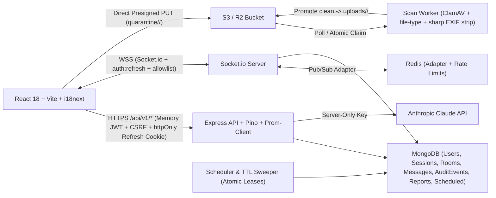

# PulseChat — Secure Real-Time Chat Platform

A production-grade, full-stack real-time chat application built with Node.js, Express, Socket.io, MongoDB/Mongoose, Redis, S3/R2 presigned storage + ClamAV quarantine scanning, Anthropic Claude AI summaries, and React 18 (Vite).

---

## Architecture



---

## Security & Authorization

- **Auth & Sessions:** Short-lived 15m in-memory JWT (`sid`-bound) + 256-bit rotating `httpOnly; SameSite=None; Secure` refresh cookie (`Path=/api/auth`) with 10s multi-tab grace window and reuse-detection family revocation.
- **Passwords & 2FA:** `argon2id` hashing (transparently rehashing legacy `bcrypt`), constant-time unknown-user login (`verifyDummyPassword`), per-account exponential backoff, k-anonymity HIBP check, AES-256-GCM encrypted TOTP secrets (`keyId` rotation), and single-use recovery codes.
- **Central RBAC (`server/src/services/permissions.js`):**

| Action | Owner | Admin | Moderator | Member | Global Admin |
| :--- | :---: | :---: | :---: | :---: | :---: |
| `room.read` / `message.send` | Yes | Yes | Yes | Yes* | Member-only** |
| `message.delete_any` / `message.pin` | Yes | Yes | Yes | No | No |
| `member.invite` (private rooms) | Yes | Yes | Yes | No | No |
| `room.rename` / `room.settings` / `member.ban` | Yes | Yes | No | No | No |
| `member.remove` (lower rank only) | Yes | Yes | No | No | No |
| `room.delete` / `ownership.transfer` | Yes | No | No | No | No |
| `admin.audit.read` (`/api/v1/admin/*`) | No | No | No | No | Yes |

\* In `announcementMode`, only `owner`/`admin`/`moderator` can post.  
\** Global admins manage platform moderation & `/api/v1/admin/*` endpoints, and do **not** automatically read private rooms or DMs.

---

## Security Headers

| Header | Value / Policy |
| :--- | :--- |
| `Content-Security-Policy` | `default-src 'self'; script-src 'self'; style-src 'self'; img-src 'self' data: blob: <S3>; connect-src 'self' <API> wss://<API>; frame-ancestors 'none'; object-src 'none'` |
| `Strict-Transport-Security` | `max-age=31536000; includeSubDomains` |
| `X-Content-Type-Options` | `nosniff` |
| `Referrer-Policy` | `strict-origin-when-cross-origin` |

---

## API Versioning & Contracts

- **REST (`/api/v1/*`):** All endpoints are served under `/api/v1/*` (with `/api/*` aliases emitting `Deprecation: true` for one release). OpenAPI 3.0.3 spec is generated from Zod schemas at [`server/openapi.json`](server/openapi.json) (`npm run openapi:check` in CI) and served at `/api/docs`.
- **Socket Contract (v1):**
  - **Client -> Server (allowlisted):** `message:send`, `message:edit`, `message:delete`, `message:read`, `reaction:toggle`, `typing:start`, `typing:stop`, `room:subscribe`, `auth:refresh`.
  - **Server -> Client:** `message:new`, `message:updated`, `message:deleted`, `message:read`, `reaction:updated`, `attachment:status`, `poll:updated`, `member:updated`, `room:created`, `room:joined`, `room:left`, `room:updated`, `room:pins_updated`, `room:unread`, `draft:updated`, `user:status_updated`, `presence:list`, `typing:start`, `typing:stop`, `auth:expired`, `session:revoked`, `notification:notice`, `server:draining`.

---

## Operational Runbook

- **Rotating JWT / Encryption Keys:** Add old key to `ENCRYPTION_PREVIOUS_KEYS={"k1":"..."}`, set `ENCRYPTION_KEY_ID=k2` and new `ENCRYPTION_KEY`, and rotate stored records with `rotateEncryptedField()`.
- **Revoking All Sessions / Incident Response:** Global admins use `POST /api/v1/admin/users/:id/force-logout` or `suspend` (immediately revokes `Session` rows and disconnects sockets across all Redis-backed nodes).
- **Infected Upload Alert:** `scanWorker` deletes the `quarantine/` object, marks `scanStatus: 'rejected'`, emits `attachment:status`, and records `upload.rejected` in `AuditEvent`.
- **Backups & Restore Drill:** See [`docs/BACKUP_RUNBOOK.md`](docs/BACKUP_RUNBOOK.md) (`RPO <= 5m`, `RTO <= 30m`, verified via `node server/src/scripts/verifyBackup.js`).
- **Threat Model & Accessibility:** See [`docs/THREAT_MODEL.md`](docs/THREAT_MODEL.md) and [`docs/ACCESSIBILITY.md`](docs/ACCESSIBILITY.md).

---

## Security Design Decisions & Interview Talking Points

1. **Refresh Token Rotation & Reuse Detection:** Rotating refresh tokens on every use and revoking the entire `familyId` when a `previousTokenHash` is replayed limits the blast radius of stolen cookies.
2. **10-Second Multi-Tab Grace Window:** Returning the current session state when `previousTokenHash` arrives within 10s prevents race-condition logouts when two browser tabs refresh simultaneously.
3. **Cross-Site Cookie Trade-Off:** Using `SameSite=None; Secure` for cross-origin deployments (Vercel + Render) paired with double-submit CSRF tokens, `Origin` verification, and `X-Requested-With`.
4. **Per-Account Exponential Backoff vs Hard Lockout:** Exponential delays (`30s` to `15m`) prevent distributed brute-force without enabling permanent lockout-DoS against victims.
5. **TOTP Replay Protection:** Storing `twoFactorLastStep` ensures a valid 6-digit code cannot be replayed within the same 30s window.
6. **Quarantine-Then-Scan Uploads:** Direct-to-S3 uploads land in `quarantine/` with `url: null` until `clamd` + magic-byte inspection + `sharp` EXIF stripping promote them to `uploads/`.
7. **Central RBAC Matrix vs Scattered Checks:** `can(user, action, resource)` in `services/permissions.js` prevents authorization drift and keeps global admins out of private rooms/DMs.
8. **Soft-Delete & Account Anonymization:** Clearing `text` to `""` and anonymizing deleted accounts to `"Deleted user"` preserves conversation continuity without retaining deleted content or PII.
9. **Atomic Scheduled Leases & Idempotency:** `findOneAndUpdate` leases + unique `Message.scheduledKey` deliver at-least-once without duplicate messages after crashes.
10. **Horizontal Scaling with Redis:** `@socket.io/redis-adapter` + `rate-limit-redis` propagate room broadcasts, rate limits, and cross-node `disconnectSockets()` revocations.

---

## Local Development

```bash
# Full stack via Docker Compose (MongoDB, Redis, ClamAV, Server, Client)
docker compose up --build

# Seed 3 demo users (alice, bob, admin) & demo rooms (dev only)
docker compose exec server npm run seed
```
