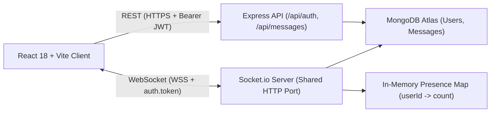

# PulseChat — Real-Time Group Chat Application

A production-style, full-stack real-time chat application built with Node.js, Express, Socket.io, MongoDB/Mongoose, and React 18 (Vite).

**Live Demo:** `https://your-deployed-client.vercel.app` *(replace with your deployed URL)*

---

## Features

- **JWT Authentication:** Case-insensitive unique usernames, bcrypt password hashing (cost 10), Zod request validation, generic auth errors, and IP-based auth rate limiting.
- **Persistent Message History:** Cursor-paginated (`before` / `after`) history stored in MongoDB with `roomId` support so private rooms/DMs can be added without a schema rewrite.
- **Real-Time Messaging:** Persist-first Socket.io delivery with optimistic UI updates, retry on failure, and per-socket sliding-window rate limiting (10 messages / 10s).
- **Multi-Tab Online Presence:** `Map<userId, connectionCount>` tracks connections per user so closing one tab does not mark a user offline while another tab remains open.
- **Typing Indicators:** Throttled `typing:start` emissions, automatic `typing:stop` on 1.5s idle, send, blur, and socket disconnect.
- **Read Receipts:** Viewport + tab-focus gated `IntersectionObserver` batches `message:read` events, persisted via `$addToSet` and displayed as `Sent` / `Seen by N` (hover or tap for reader names).
- **Reconnect Catch-Up:** Automatic refetch of messages newer than the last known timestamp (`?after=`) on reconnect, deduplicated by `_id`.

---

## Architecture



---

## REST API Contract

| Method | Endpoint | Auth | Body / Query | Response |
| :--- | :--- | :--- | :--- | :--- |
| `GET` | `/health` | Public | — | `200 { status, uptime, timestamp }` |
| `POST` | `/api/auth/register` | Public (10/15m) | `{ username, password }` | `201 { token, user }` |
| `POST` | `/api/auth/login` | Public (10/15m) | `{ username, password }` | `200 { token, user }` |
| `GET` | `/api/messages` | Bearer JWT | `?before=<ISO>&after=<ISO>&limit=50&roomId=global` | `200 { messages, hasMore }` |

---

## Socket.io Event Contract

All socket connections require a valid JWT in `socket.handshake.auth.token`; invalid tokens are rejected with `connect_error: unauthorized`.

| Event | Direction | Payload | Purpose |
| :--- | :--- | :--- | :--- |
| `message:send` | Client → Server | `{ text, roomId? }`, ack `(res)` | Validates, persists to MongoDB, broadcasts `message:new`, acks `{ ok, id }` |
| `message:new` | Server → Client | `{ _id, roomId, sender, senderName, text, readBy, createdAt }` | Delivers persisted message to all clients in the room |
| `presence:list` | Server → Client | `[{ userId, username }]` | Broadcasts full online user list on connect / last-tab disconnect |
| `typing:start` | Bidirectional | Client: `{ roomId? }` / Server: `{ userId, username }` | Relays active typing state to other room members |
| `typing:stop` | Bidirectional | Client: `{ roomId? }` / Server: `{ userId, username }` | Clears typing indicator on idle, send, blur, or disconnect |
| `message:read` | Bidirectional | Client: `{ messageIds, roomId? }` / Server: `{ messageIds, userId, username }` | Persists `userId` via `$addToSet` and broadcasts read update |

---

## Local Setup

### Prerequisites
- Node.js 20+
- A MongoDB connection string (local MongoDB or MongoDB Atlas free tier)

### 1. Server
```bash
cd server
cp .env.example .env
# Edit .env with your MONGO_URI and a 32+ character JWT_SECRET
npm install
npm run dev
```

### 2. Client
```bash
cd client
cp .env.example .env
# Ensure VITE_API_URL=http://localhost:4000
npm install
npm run dev
```

Open `http://localhost:5173` in two browser windows (or incognito + normal) to test real-time chat.

### Running Tests & Lint
```bash
cd server && npm run lint && npm run test:coverage
cd client && npm run lint && npm run build
```

---

## Security Checklist & Trade-offs

- **Helmet & Strict CORS:** `helmet()` sets security headers; CORS is restricted to `env.CLIENT_URL` on both Express and Socket.io.
- **Input Validation:** Every REST body/query and Socket payload is validated with `zod` before touching the database.
- **Rate Limiting:** Auth routes are limited to 10 requests per 15 minutes per IP (`express-rate-limit`); `message:send` is limited to 10 messages per 10 seconds per socket.
- **Generic Auth Errors:** Login returns `"Invalid username or password"` for both unknown usernames and wrong passwords to prevent user enumeration.
- **XSS Prevention:** React escapes all message text by default (`dangerouslySetInnerHTML` is never used).
- **No Secrets in Repo:** `.env` files are gitignored; `.env.example` files contain placeholders only.
- **`localStorage` vs `httpOnly` Cookies:** This app stores the JWT in `localStorage` so it can be attached cleanly to both `fetch` headers and `socket.handshake.auth.token` across separate frontend/backend origins (Vercel + Render). The trade-off is that `localStorage` is readable by any JS running on the origin (making XSS prevention critical), whereas `httpOnly` cookies are immune to JS access but require same-site/CORS cookie configuration and CSRF protection.

---

## Deployment Guide

### 1. MongoDB Atlas (Database)
1. Create a free M0 cluster on [MongoDB Atlas](https://www.mongodb.com/atlas).
2. Create a database user with read/write permissions.
3. Under **Network Access**, add your server host's outbound IPs (or `0.0.0.0/0` for dynamic PaaS IPs on Render/Railway free tiers, paired with a strong DB password).
4. Copy the `mongodb+srv://...` connection string.

### 2. Server on Render (or Railway)
A [`render.yaml`](render.yaml) blueprint is included.
- **Root Directory:** `server`
- **Build Command:** `npm ci`
- **Start Command:** `npm start`
- **Health Check Path:** `/health`
- **Environment Variables:**
  - `NODE_ENV=production`
  - `PORT=4000`
  - `MONGO_URI=<your Atlas URI>`
  - `JWT_SECRET=<random 32+ char secret>`
  - `CLIENT_URL=https://your-frontend.vercel.app`
- Render and Railway support WebSockets natively over HTTPS/WSS on the single exposed port.

### 3. Client on Vercel (or Netlify)
SPA fallback configs are included ([`client/vercel.json`](client/vercel.json) and [`client/public/_redirects`](client/public/_redirects)).
- **Root Directory:** `client`
- **Build Command:** `npm run build`
- **Output Directory:** `dist`
- **Environment Variables:**
  - `VITE_API_URL=https://your-server.onrender.com`

> **Important Deployment Warnings:**
> - `CLIENT_URL` on the server **must match the frontend origin exactly** (including `https://` and **no trailing slash**), otherwise both CORS and Socket.io handshakes will be rejected.
> - **Free-tier cold starts:** Render's free tier spins down after 15 minutes of inactivity; the first request or WebSocket connection after idle may take 30–50 seconds while the container wakes up.

---

## What I'd Do Next

- **Private Rooms & DMs:** Add a `Room` model (`members`, `type: 'group' | 'dm'`) and join `socket.join(roomId)` dynamically on room selection (the `Message.roomId` field is already in place).
- **Horizontal Scaling with Redis:** Plug in `@socket.io/redis-adapter` and move the presence map to Redis hashes (`HINCRBY`) so multiple server instances share room broadcasts and online state.
- **File & Image Uploads:** Issue pre-signed S3/R2 URLs from Express so binary uploads bypass the Node.js event loop.
- **Message Editing & Deleting:** Add `editedAt` / `deletedAt` soft-delete fields and broadcast `message:updated` / `message:deleted` events.

---

## Interview Talking Points

1. **Why persist before broadcast?** Persisting to MongoDB *before* emitting `message:new` guarantees every delivered message has a canonical `_id` and `createdAt`, prevents phantom messages that vanish on refresh if the DB write fails, and lets the ack callback confirm durability to the sender.
2. **How does presence handle multiple tabs?** A `Map<userId, { userId, username, count }>` increments on each authenticated socket connection and decrements on disconnect. A user is only removed from the online list and broadcast as offline when `count` reaches `0`.
3. **How is JWT shared between REST and sockets?** Both layers use the same `verifyToken()` helper against `JWT_SECRET`. REST passes it in `Authorization: Bearer <token>`, while Socket.io passes it in `socket.handshake.auth.token` (avoiding query-string token leakage in server/proxy logs).
4. **Why cursor pagination (`before` / `after`) instead of `skip`/`limit`?** In a live chat stream, new messages constantly shift offsets, causing `skip` to duplicate or skip messages. Cursor pagination on an indexed `createdAt` field stays $O(\log N)$ and handles both older history (`before`) and reconnect catch-up (`after`).
5. **How would this scale beyond one server?** Replace the in-memory Socket.io adapter with `@socket.io/redis-adapter` for cross-node pub/sub, move presence counts to Redis, and put a sticky-session or WebSocket-capable load balancer in front of stateless Node.js instances.
