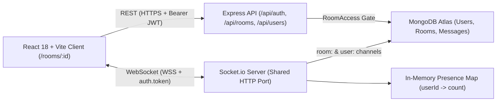

# PulseChat — Real-Time Group Chat, Rooms & Direct Messages

A production-style, full-stack real-time chat application built with Node.js, Express, Socket.io, MongoDB/Mongoose, and React 18 (Vite). Supports public & private rooms, 1-to-1 direct messages, JWT authentication, persistent cursor-paginated history, multi-tab presence, room-scoped typing indicators, and read receipts.

**Live Demo:** `https://your-deployed-client.vercel.app` *(replace with your deployed URL)*

---

## Features

- **Public Rooms, Private Rooms & 1-to-1 DMs:** Seeded `"General"` public room (auto-joined on registration), discoverable public rooms, owner-managed invite-only private rooms, and race-safe deduplicated DMs.
- **JWT Authentication:** Case-insensitive unique usernames, bcrypt password hashing (cost 10), Zod request validation, generic auth errors, and IP-based auth rate limiting.
- **Persistent Message History:** Cursor-paginated (`before` / `after`) history per room stored in MongoDB with `{ room: 1, createdAt: -1 }`.
- **Real-Time Messaging:** Persist-first Socket.io delivery scoped to `room:<roomId>` with optimistic UI updates, retry on failure, and per-socket sliding-window rate limiting (10 messages / 10s across all rooms).
- **Multi-Tab Online Presence & Personal Channels:** `Map<userId, connectionCount>` tracks connections per user; `user:<userId>` personal channels deliver live room invites, DM creations, and multi-tab unread syncs without reconnecting.
- **Typing Indicators & Read Receipts:** Room-scoped throttled typing indicators (cleared on send, idle, blur, and disconnect) and `IntersectionObserver` + tab-focus gated read receipts (`$addToSet` + `members.lastReadAt`).
- **Reconnect Catch-Up & URL Routing:** `/rooms/:id` URL state with refresh/back-button support, and automatic per-room `?after=` catch-up on reconnect deduplicated by `_id`.

---

## Architecture



---

## Authorization Model

All room-scoped REST endpoints and Socket.io handlers pass through [`server/src/services/roomAccess.js`](server/src/services/roomAccess.js) (`getRoomIfMember` / `assertRoomOwner`):
1. Every `roomId` is validated with `mongoose.isValidObjectId` via Zod before any database query (`400` on malformed IDs).
2. Non-members receive `403` for public rooms and `404` for private rooms and DMs so private room existence cannot be enumerated via IDOR.
3. Only members can read history, send messages, emit typing, or mark messages read.
4. Only the room `owner` can invite users to a private room or delete a non-General room.

---

## REST API Contract

| Method | Endpoint | Auth | Body / Query | Response |
| :--- | :--- | :--- | :--- | :--- |
| `GET` | `/health` | Public | — | `200 { status, uptime, timestamp }` |
| `POST` | `/api/auth/register` | Public (10/15m) | `{ username, password }` | `201 { token, user }` |
| `POST` | `/api/auth/login` | Public (10/15m) | `{ username, password }` | `200 { token, user }` |
| `GET` | `/api/rooms` | Bearer JWT | — | `200 { rooms }` (with `lastMessage`, `unreadCount`, `otherUser`) |
| `GET` | `/api/rooms/public` | Bearer JWT | `?q=&page=1&limit=20` | `200 { rooms, page, limit, total, hasMore }` |
| `POST` | `/api/rooms` | Bearer JWT | `{ name, type, memberIds? }` | `201 { room }` |
| `POST` | `/api/rooms/dm` | Bearer JWT | `{ userId }` | `200/201 { room, created }` |
| `POST` | `/api/rooms/:id/join` | Bearer JWT | — | `200 { room }` |
| `POST` | `/api/rooms/:id/members` | Owner JWT | `{ memberIds }` | `200 { room, addedMemberIds }` |
| `DELETE` | `/api/rooms/:id/members/me` | Bearer JWT | — | `200 { ok, roomId }` |
| `DELETE` | `/api/rooms/:id` | Owner JWT | — | `200 { ok, roomId }` |
| `GET` | `/api/rooms/:id/messages` | Member JWT | `?before=<ISO>&after=<ISO>&limit=50` | `200 { messages, hasMore }` |
| `GET` | `/api/users` | Bearer JWT | `?q=<prefix>` | `200 { users }` (max 20, excludes self) |
| `GET` | `/api/messages` *(deprecated)* | Bearer JWT | `?before=&after=&limit=50` | `200 { messages, hasMore }` (General room fallback) |

---

## Socket.io Event Contract

All socket connections require a valid JWT in `socket.handshake.auth.token` (rejected with `connect_error: unauthorized`). On connect, sockets join `user:<userId>` and `room:<roomId>` for all rooms they belong to.

| Event | Direction | Payload | Purpose |
| :--- | :--- | :--- | :--- |
| `message:send` | Client → Server | `{ roomId, text }`, ack `(res)` | Validates membership, persists to MongoDB, emits `message:new` & `room:unread`, acks `{ ok, id }` |
| `message:new` | Server → Client | `{ _id, room, sender, senderName, text, readBy, createdAt }` | Delivers persisted message to `room:<roomId>` |
| `typing:start` | Bidirectional | Client: `{ roomId }` / Server: `{ roomId, userId, username }` | Relays active typing state to `room:<roomId>` |
| `typing:stop` | Bidirectional | Client: `{ roomId }` / Server: `{ roomId, userId, username }` | Clears typing indicator on idle, send, blur, or disconnect across all rooms |
| `message:read` | Bidirectional | Client: `{ roomId, messageIds }` / Server: `{ roomId, messageIds, userId, username }` | `$addToSet` on `readBy`, updates `members.lastReadAt`, emits to room & syncs `room:unread` |
| `room:created` | Server → Client | `{ room }` | Sent to `user:<id>` when invited to a private room or when a DM is created |
| `room:joined` | Server → Client | `{ room }` or `{ roomId, user / addedMemberIds }` | Updates live membership in sidebar & room header |
| `room:left` | Server → Client | `{ roomId, userId?, deleted? }` | Removes room or member live and detaches sockets via `socketsLeave` |
| `room:unread` | Server → Client | `{ roomId, unreadCount }` | Sent to `user:<id>` when messages arrive in background rooms or are read in another tab |
| `room:subscribe` | Client → Server | `{ roomId }`, ack `(res)` | Re-verifies membership and re-joins `room:<roomId>` after reconnects |
| `presence:list` | Server → Client | `[{ userId, username }]` | Broadcasts global online users on connect / last-tab disconnect |

---

## Local Setup & Migration

### Prerequisites
- Node.js 20+
- MongoDB (local Docker `mongo:7` or MongoDB Atlas free tier)

### 1. Server
```bash
cd server
cp .env.example .env
# Edit .env with your MONGO_URI and a 32+ character JWT_SECRET
npm install
npm run migrate:rooms   # idempotent: seeds General room & migrates legacy messages
npm run dev
```

### 2. Client
```bash
cd client
cp .env.example .env
# Ensure VITE_API_URL=http://localhost:4000
npm install
npm run dev
```

### Running Tests & Lint
```bash
cd server && npm run lint && npm run test:coverage
cd client && npm run lint && npm run build
```

---

## Design Decisions & Hardening

- **Embedded `members` vs. Separate `Membership` Collection:** `Room.members` embeds `{ user, role, joinedAt, lastReadAt }` directly inside each `Room` document and is capped at `MAX_MEMBERS_PER_ROOM = 100` (and `MAX_ROOMS_PER_USER = 50`). This makes room authorization and member-list rendering a single document read. *When to switch:* If rooms grow to thousands of members (e.g., Discord-sized servers), move `members` to a dedicated `Membership` collection to avoid the 16 MB BSON limit and write contention on the `Room` document.
- **`dmKey` for Race-Safe DMs:** `dmKey = [idA, idB].sort().join(':')` with a `{ unique: true, sparse: true }` index guarantees two users can never create duplicate DMs even under simultaneous `POST /api/rooms/dm` calls (any `E11000` falls back to returning the existing room).
- **Personal `user:<id>` Channels for Live Joins:** Inviting or adding a user calls `io.in('user:' + id).socketsJoin('room:' + roomId)` and emits `room:created` to `user:<id>`, so all open tabs of that user receive messages immediately without refreshing.
- **Authorization at the Handler Level:** Every REST route and socket event calls `getRoomIfMember` before reading or mutating data; Socket.io room membership is never treated as a substitute for server-side authorization.
- **Unread Count Cost Trade-Off:** `GET /api/rooms` computes `unreadCount` via indexed `countDocuments({ room, createdAt: { $gt: lastReadAt }, sender: { $ne: userId } })` using `{ room: 1, createdAt: -1 }`. This is fast up to `MAX_ROOMS_PER_USER = 50`; at larger scale, we would maintain a denormalized per-`(user, room)` counter incremented on `message:send` and reset on `message:read`.
- **Scaling Beyond One Server:** With multiple Node.js instances, in-memory Socket.io rooms and presence maps do not cross process boundaries. Add `@socket.io/redis-adapter` so `io.to('room:' + id)` and `io.in('user:' + id).socketsJoin(...)` propagate across all nodes, and move the presence map to Redis hashes (`HINCRBY`).

---

## Security Checklist & Trade-offs

- **Helmet & Strict CORS:** `helmet()` sets security headers; CORS is restricted to `env.CLIENT_URL` on both Express and Socket.io.
- **Input Validation:** Every REST body/query and Socket payload is validated with `zod` (`mongoose.isValidObjectId` for all IDs; room names restricted to `[a-zA-Z0-9 _-]+` and case-insensitively unique for public rooms).
- **Rate Limiting:** Auth routes: 10 req / 15 min per IP; Room/User API routes: 200 req / min per IP; `message:send`: 10 msgs / 10s per socket.
- **XSS Prevention:** React escapes all text by default (`dangerouslySetInnerHTML` is never used).
- **`localStorage` vs `httpOnly` Cookies:** JWT is stored in `localStorage` so it can be attached cleanly to both `fetch` headers and `socket.handshake.auth.token` across separate Vercel/Render origins; `httpOnly` cookies avoid JS token access but require same-site cookie/CSRF configuration.

---

## Deployment Guide

1. **MongoDB Atlas:** Create a free M0 cluster, create a DB user, allow server IPs under **Network Access**, and copy the `mongodb+srv://...` URI.
2. **Server on Render (`render.yaml`):** Root directory `server`, build `npm ci`, start `npm start`, health check `/health`, env vars `NODE_ENV=production`, `PORT=4000`, `MONGO_URI`, `JWT_SECRET` (32+ chars), `CLIENT_URL` (exact frontend origin, no trailing slash).
3. **Client on Vercel / Netlify (`client/vercel.json`, `client/public/_redirects`):** Root directory `client`, build `npm run build`, output `dist`, env var `VITE_API_URL`.
4. **Cold-start note:** Free-tier Render instances spin down after 15 minutes of inactivity; the first request/WS handshake after idle may take 30–50 seconds.

---

## Interview Talking Points

1. **Why persist before broadcast?** Persisting to MongoDB *before* emitting `message:new` guarantees every delivered message has a canonical `_id` and `createdAt`, prevents phantom messages on refresh if the DB write fails, and lets the ack callback confirm durability.
2. **How does presence handle multiple tabs?** A `Map<userId, { userId, username, count }>` increments on connect and decrements on disconnect, broadcasting offline only when `count === 0`.
3. **How is JWT shared between REST and sockets?** Both use `verifyToken()` against `JWT_SECRET`: REST via `Authorization: Bearer <token>`, sockets via `socket.handshake.auth.token`.
4. **Why cursor pagination (`before` / `after`)?** Live chat streams constantly shift offsets; cursor pagination on `{ room: 1, createdAt: -1 }` stays $O(\log N)$ and powers both older history and reconnect catch-up.
5. **Why embedded `members` instead of a `Membership` collection?** With a 100-member cap per room, embedding gives single-query authorization and member rendering; at thousands of members per room, a separate `Membership` collection avoids 16 MB BSON limits and write contention.
6. **How does `dmKey` prevent duplicate DMs under race conditions?** Sorting `[idA, idB].sort().join(':')` with a unique sparse index turns concurrent `POST /api/rooms/dm` requests into an atomic DB constraint check (`E11000` falls back to returning the existing room).
7. **How do live room invites work across multiple tabs?** `io.in('user:' + id).socketsJoin('room:' + roomId)` + `room:created` on `user:<id>` attaches all open tabs of the invited user immediately without reconnecting.
8. **Why return `404` instead of `403` for private/DM non-members?** Returning `403` confirms a guessed ObjectId belongs to a real private room or DM; returning `404` prevents IDOR existence enumeration.
9. **How would this scale beyond one server?** Add `@socket.io/redis-adapter` so `io.to('room:' + id)` and `socketsJoin`/`socketsLeave` reach sockets on other Node instances, and store presence counts in Redis.
